# Mockcat

**Mockcat** is a Kotlin Multiplatform toolkit for HTTP mocking, traffic inspection, and interactive mock rule editing — without touching your production code.

📖 **[Full documentation →](https://surajbichkunde39.github.io/Mockcat-KMP/)**

---

## What it does

- **Intercept** — Return saved responses or redirect requests at runtime. Rules are stored in a local database, editable in a built-in Compose UI.
- **Log** — Capture every HTTP call (headers, body, timing) and inspect it in-app without a proxy.
- **Push mocks over ADB** — The Gradle plugin reads JSON files from your project and loads them into a connected device in one command.

Supports Android (OkHttp, Ktor) and iOS (URLSession).

---

## Screenshots

### HTTP Logger

<details>
<summary>Light theme</summary>

<table>
  <tr>
    <td align="center"><b>Log List</b></td>
    <td align="center"><b>Overview</b></td>
    <td align="center"><b>Request</b></td>
    <td align="center"><b>Response</b></td>
  </tr>
  <tr>
    <td>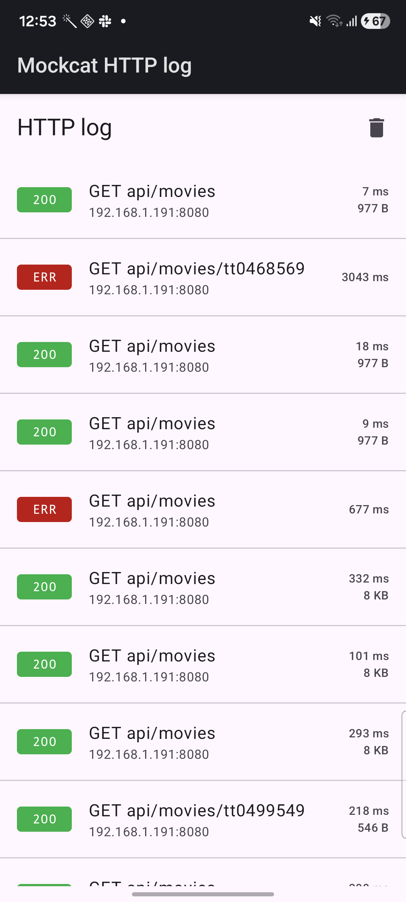</td>
    <td>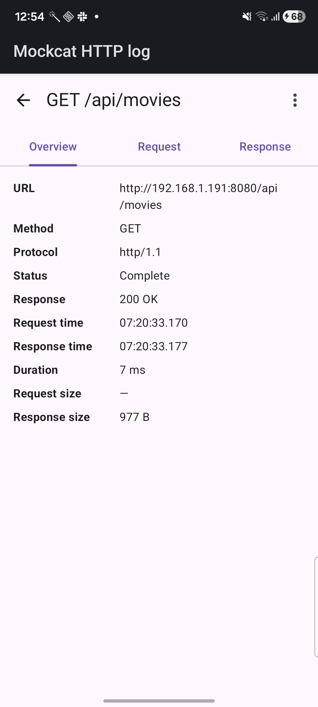</td>
    <td>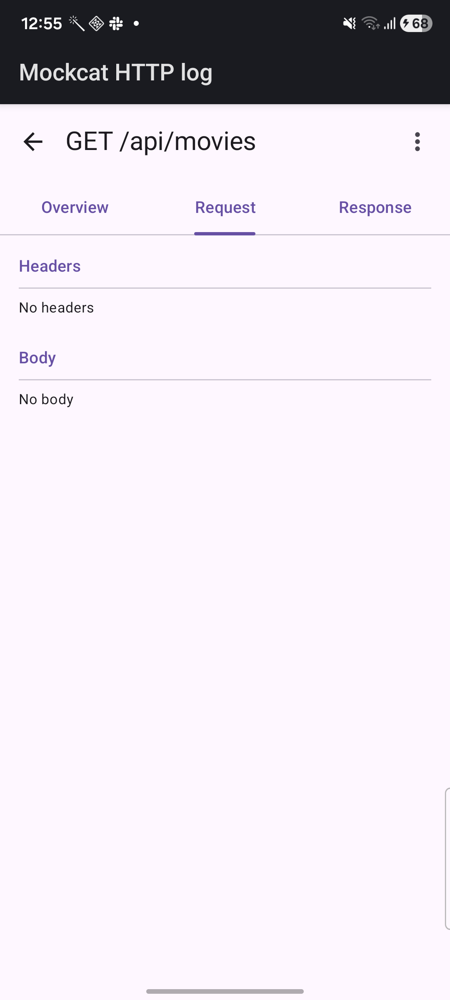</td>
    <td>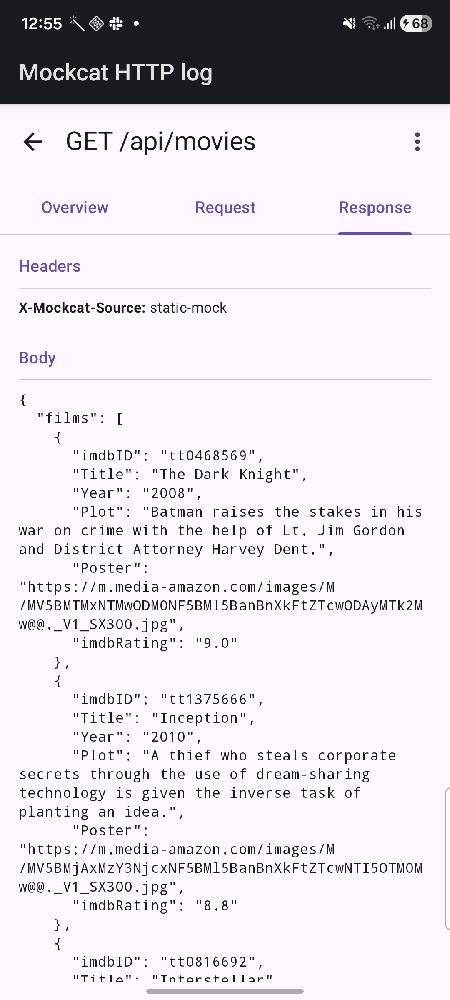</td>
  </tr>
</table>

</details>

<details>
<summary>Dark theme</summary>

<table>
  <tr>
    <td align="center"><b>Log List</b></td>
    <td align="center"><b>Overview</b></td>
    <td align="center"><b>Request</b></td>
    <td align="center"><b>Response</b></td>
  </tr>
  <tr>
    <td>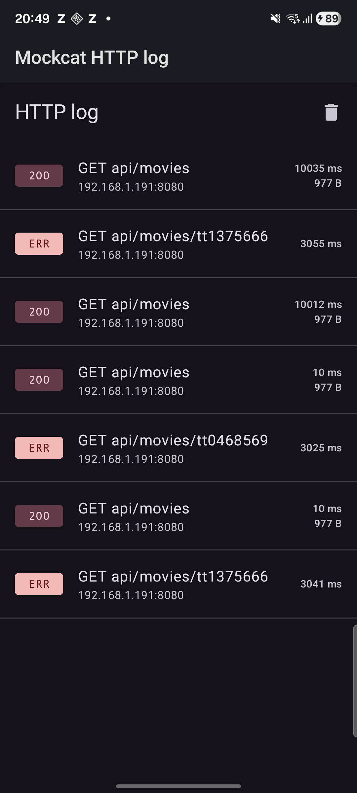</td>
    <td>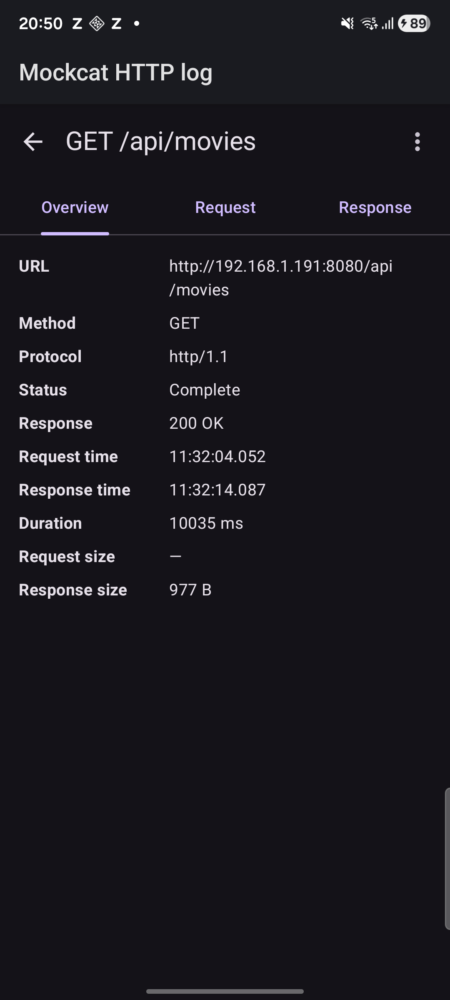</td>
    <td>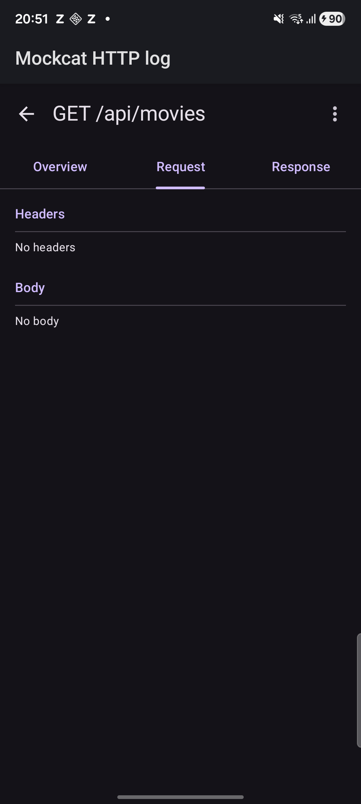</td>
    <td>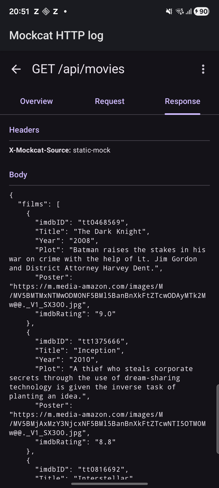</td>
  </tr>
</table>

</details>

### Mock Intercept

<details>
<summary>Light theme</summary>

<table>
  <tr>
    <td align="center"><b>Mock Rules</b></td>
    <td align="center"><b>Edit Rule</b></td>
  </tr>
  <tr>
    <td>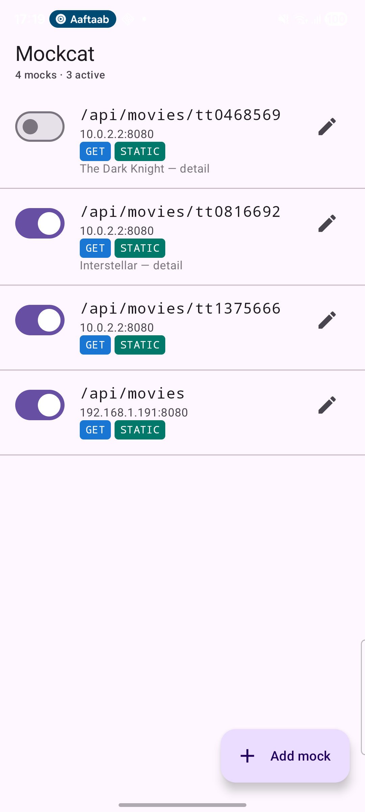</td>
    <td>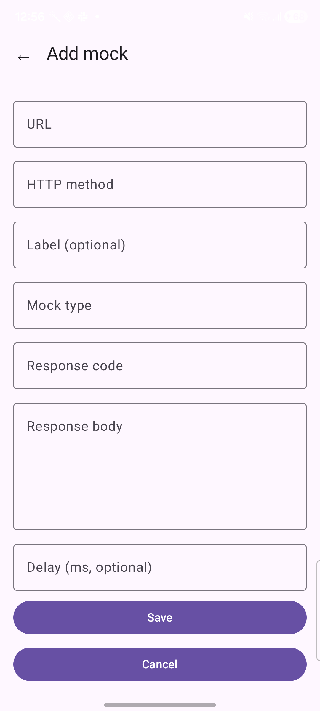</td>
  </tr>
</table>

</details>

<details>
<summary>Dark theme</summary>

<table>
  <tr>
    <td align="center"><b>Mock Rules</b></td>
    <td align="center"><b>Edit Rule</b></td>
  </tr>
  <tr>
    <td>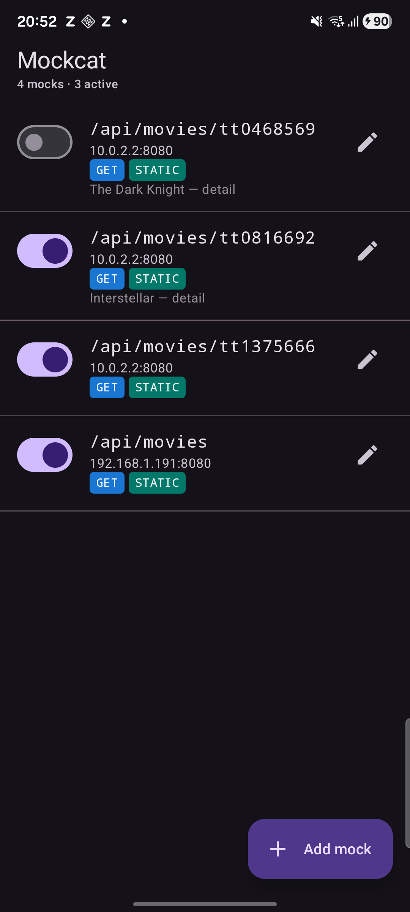</td>
    <td>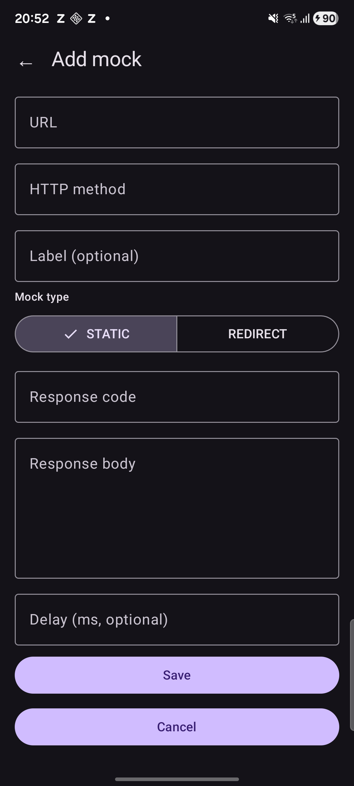</td>
  </tr>
</table>

</details>

---

## Quick start

```kotlin title="app/build.gradle.kts"
dependencies {
    debugImplementation("com.mockcat:mockcat-intercept-okhttp:0.1.0")
    debugImplementation("com.mockcat:mockcat-intercept-ui:0.1.0")
    debugImplementation("com.mockcat:mockcat-logger-okhttp:0.1.0")
    debugImplementation("com.mockcat:mockcat-logger-ui:0.1.0")
    releaseImplementation("com.mockcat:mockcat-noop-android:0.1.0")
}
```

```kotlin
val mockcatIntercept = MockcatIntercept(context)
val mockcatLogger = MockcatLogging(context)

val client = OkHttpClient.Builder()
    .addInterceptor(mockcatLogger)
    .addInterceptor(mockcatIntercept)
    .build()
    .also { mockcatIntercept.bindClient(it) }
```

```bash
./gradlew mockcatImport   # push mocks from app/mocks/*.json to connected device
```

See the **[Quick Start guide](https://surajbichkunde39.github.io/Mockcat-KMP/getting-started/quick-start/)** for the full walkthrough.

---

## Documentation

Full docs at **[surajbichkunde39.github.io/Mockcat-KMP](https://surajbichkunde39.github.io/Mockcat-KMP/)** — installation, guides for OkHttp/Ktor/URLSession, mock file format, Gradle plugin, architecture, and more.

---

## Requirements

- JDK 17+, Android Gradle Plugin 9.x, Kotlin 2.x, minSdk 24+
- iOS: Xcode 15+, `iosArm64` / `iosSimulatorArm64`

## Contributing

Prefer small, focused changes. Keep `commonMain` free of platform types in `mockcat-api`. After Kotlin edits, run `./gradlew ktlintCheck detekt`. Open issues or pull requests against the default branch.
